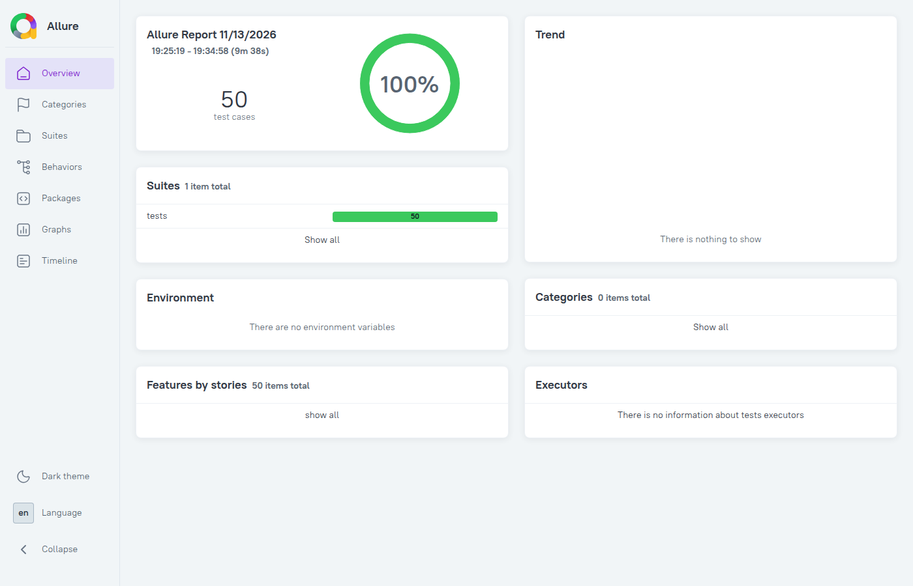

# Totebox Appium (Python + pytest)

[](https://github.com/seandas/totebox-appium-python/actions/workflows/ci.yml)

UI test automation for **Totebox**, a small Kotlin shopping app, using Python, pytest,
Appium (UiAutomator2) and the Page Object pattern. It is the Appium counterpart to the
[Espresso suite](https://github.com/seandas/totebox-espresso-test) that lives with the app's
source, and covers the same flows: 50 tests, all passing.

```
pytest  --->  Appium server (127.0.0.1:4723)  --->  Android emulator/device  --->  Totebox
```

## Layout

```
apps/totebox-debug.apk   the app under test (debug build, bundled so a clone runs as-is)
config/capabilities.py   Appium session options, env-overridable
pages/                   page objects: base_page, toolbar, login, products, product_detail,
                         cart (cart + saved for later tabs), checkout, order_complete, settings
tests/                   conftest.py (driver, restart, failure artifacts), data.py, test_*.py
artifacts/               screenshot + UI dump + logcat of each failed test (git-ignored)
```

## Setup

1. Android SDK with an emulator (API 26+) or a device, `adb devices` showing it.
2. Appium 2/3 with the driver: `appium driver install uiautomator2`.
3. Python environment:
   ```bash
   python3 -m venv .venv && source .venv/bin/activate
   pip install -r requirements.txt
   ```

## Run

```bash
appium &                                  # in another terminal
pytest                                    # everything (50 tests)
pytest -m smoke                           # critical path only
pytest -m "regression and not crash"
pytest tests/test_cart.py -k shipping
```

Environment overrides: `APPIUM_SERVER_URL`, `ANDROID_DEVICE_NAME`, `ANDROID_UDID`,
`ANDROID_PLATFORM_VERSION`, `ANDROID_APP_PATH` (use another build of the app).

The APK is bundled, so nothing else is needed. To test a newer build, get the app source from
[totebox-espresso-test](https://github.com/seandas/totebox-espresso-test), run
`./gradlew assembleDebug`, and point `ANDROID_APP_PATH` at `app/build/outputs/apk/debug/app-debug.apk`
(or copy it to `apps/totebox-debug.apk`).

### CI

GitHub Actions starts an API 34 emulator, installs Appium 3.9.0 with the UiAutomator2 driver, and runs
the `smoke` tests on every push and pull request. Run the workflow manually to pick another marker
or to run all 50 tests. The raw Allure results are uploaded as a build artifact.

### Reports

`allure-pytest` writes raw results to `allure-results/`; view them with the Allure CLI
(`allure serve allure-results`). Failed tests attach a screenshot, the UI hierarchy and the
device log; the same files are saved in `artifacts/`.



## Design notes

- **One session, fresh app per test.** Starting an Appium session is the slow part, so the
  session is shared. Totebox keeps all state in memory, so the `driver` fixture kills the app and
  starts the login screen in a new task before every test: each test starts logged out with an
  empty cart and is independent of order.
- **Locators** are resource IDs (`rid("login_button")`) and accessibility labels. Product-row
  buttons are found by the labels the app gives them, e.g. `Add Canvas Tote Bag to cart`.
  Material field errors are located as children of each field's layout.
- **No sleeps.** Everything uses explicit waits. The product list waits out the app's simulated
  network delay; toasts and snackbars are read while they are visible.
- **Swipe to place order** is a `mobile: dragGesture` starting on the slider's handle; a half
  swipe is a test that the order is *not* placed.

## Coverage

| File | Covers |
|---|---|
| `test_login.py` | login + toast, guest, helper text, required fields, email format, password rules, locked account |
| `test_products.py` | list loads, three sort orders, add to cart + badge, save for later, crash item |
| `test_product_detail.py` | quantity stepper limits, add to cart snackbar + "View cart", 10-item limit |
| `test_cart.py` | totals, shipping fee and free-shipping threshold, remove, empty state, start shopping |
| `test_saved_for_later.py` | save, move back, delete, product returns to the list |
| `test_checkout.py` | card and pay-on-delivery orders, half swipe, required fields, ZIP and card rules |
| `test_guest_checkout.py` | guest must log in, cart is kept, back returns to the cart |
| `test_settings.py` | account line, guest mode, network speed & load time, Home menu, guest Log in, log out |
